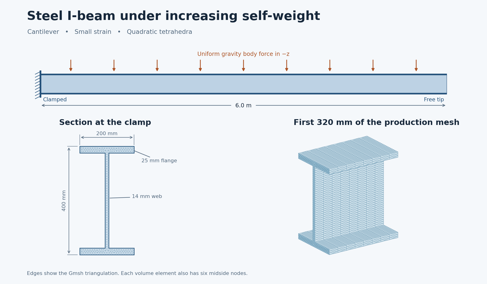
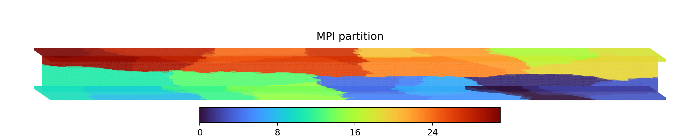
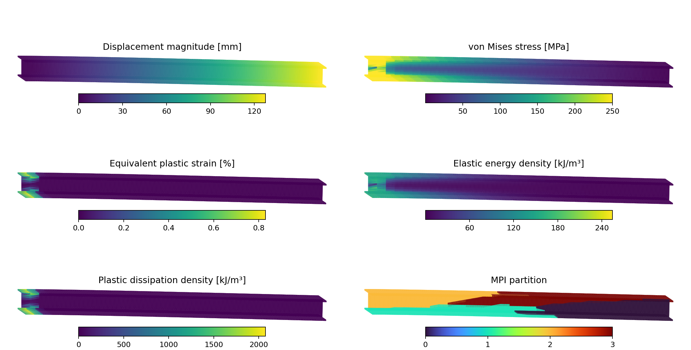
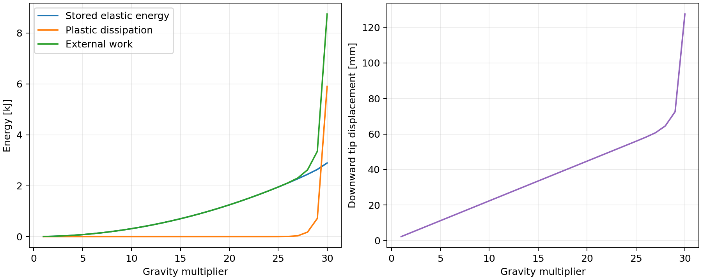
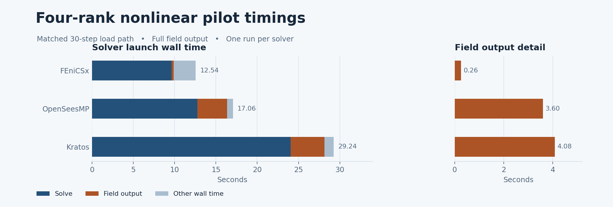

# An I-beam approaching plastic collapse

**Esmeralda · OpenSeesMP · Kratos Multiphysics · FEniCSx**

Three independently implemented models of the same steel cantilever reached **30× gravity** on the common quadratic pilot mesh. The three predicted a downward tip displacement of **127.53 mm**, with a spread of **0.46 µm**. This report records the model, the meshes, the measured pilot timings, and the status of the production benchmark.

[Model and mesh](#model-and-mesh) · [Response](#nonlinear-response) · [Timings](#measured-performance) · [Rank scaling and beam limit](results/esmeralda/scaling.md) · [Visualization](#open-the-model-and-results)

## Model and mesh

The 6 m steel I-beam is clamped on its entire root face at $x=0$. All three translations are fixed there, including at midside nodes. The far end is free. The solvers apply a downward body force per unit volume of $\rho\lambda g$, where $\lambda$ is the gravity multiplier. The section is 400 mm deep and 200 mm wide, with 25 mm flanges and a 14 mm web.

| Property | Value |
| --- | ---: |
| Young’s modulus | 210 GPa |
| Poisson’s ratio | 0.30 |
| Density | 7,850 kg/m³ |
| J2 yield stress | 250 MPa |
| Reference gravity | 9.80665 m/s² |
| Nominal section plastic moment | 575.94 kN·m |

The material is associative von Mises (J2) elastic–perfectly plastic. The continuum model uses small-strain kinematics, which makes the study a test of **material collapse**. Geometric instability and local or lateral-torsional buckling would require a different model. A section calculation gives **27.895× gravity** at the nominal plastic moment. It serves as a reference for the three-dimensional load path.

Gmsh 4.15.1 generated straight-sided ten-node tetrahedra with four integration points per element. All solvers receive the same node coordinates and volume connectivity, with solver-specific node orderings. Each solver partitions the shared mesh through its normal workflow. The inputs use metres and meganewtons internally and export SI values.

| Mesh | Quadratic tetrahedra | Nodes | Target section / axial spacing | Gmsh file |
| --- | ---: | ---: | --- | --- |
| Smoke | 7,140 | 13,041 | 35 / 180 mm | [Download](model/meshes/smoke.msh.gz) |
| Refinement | 69,600 | 116,781 | 14 / 60 mm | [Download](model/meshes/refinement.msh.gz) |
| Production | 237,600 | 372,337 | 9 / 40 mm | [Download](model/meshes/production.msh.gz) |

Unzip the `.msh.gz` file and open the resulting `.msh` in Gmsh. The [model parameters](model/beam.json) and [mesh generator](model/mesh.py) define all three resolutions. The input scripts show the implementations side by side. [OpenSeesMP](solvers/opensees.tcl) · [Kratos](solvers/kratos.py) · [FEniCSx](solvers/fenicsx.py)

*Planned OpenSeesMP production partition. The realized FEniCSx partitions from the RoCE and TCP pilots are available as separate VTK files below.*

## Nonlinear response

The matched smoke runs used four MPI ranks, 30 equal gravity increments, and a complete field dump at each accepted step. At the final increment, roughly **94% of the integration points** in elements with centroids within 180 mm of the clamp reached at least 99.9% of yield stress in the OpenSeesMP and FEniCSx runs. The last increment added about **55 mm** of downward tip motion, compared with about **2.24 mm** per increment in the elastic range.

| At 30× gravity | OpenSeesMP | Kratos | FEniCSx |
| --- | ---: | ---: | ---: |
| Downward tip displacement | 127.5277 mm | 127.5281 mm | 127.5281 mm |
| Peak von Mises stress | 250.00002 MPa | 250.00000 MPa | 250.00000 MPa |
| Stored elastic energy | 2.89271 kJ | 2.89271 kJ | 2.89271 kJ |
| Plastic dissipation | 5.90227 kJ | 5.90231 kJ | 5.90231 kJ |
| External work | 8.74660 kJ | 8.74665 kJ | 8.74665 kJ |
| Energy balance difference | 0.553% | 0.553% | 0.553% |

*FEniCSx smoke mesh at 30× gravity, deformed at true scale. Yielding is concentrated at the clamp on the left. The stored energy and plastic dissipation are reconstructed from the integration-point histories. The energy balance includes numerical integration of external work over the 30 load increments.*

The refinement FEniCSx run reached 29× gravity and 78.84 mm downward tip displacement. Newton failed at 30× on that mesh. On the production mesh, FEniCSx reached 29× and 81.69 mm downward displacement before MUMPS returned error −9 at the last increment. Kratos with serial KLU failed Newton convergence on its first production-mesh increment. All three updated Kratos direct backends completed the two-step production-mesh elastic test on 16 ranks and agreed with FEniCSx at 1× gravity. MUMPS finished in 64.047 s, Amesos2 SuperLU_DIST in 69.640 s, and Amesos SuperLU_DIST in 204.698 s. The three-dimensional limit and a common production load path remain to be verified. [Refinement history](results/esmeralda/fenicsx-refinement-tip.csv) · [Production history](results/esmeralda/fenicsx-production-tip.csv)

## Measured performance

The original CPU runs included a slower memory configuration on node12, identified after the sweeps. Single-node rank comparisons pool unequal numbers of runs from each host, and all 32-rank runs include node12. [Hardware diagnosis and timing context](results/esmeralda/scaling.md#openseesmp-single-node-audit)

The balanced follow-up validated 108 single-node timings on node13. On the fine mesh, OpenSeesMP and FEniCSx improved through 16 ranks, while Kratos reached its best time at 8. On the coarse mesh, 8 ranks was fastest for all three solvers. [Node13 timings](results/esmeralda/node13-timings.md)

The smoke and fine sweeps validated all 180 runs. The final tables cover 4, 8, 16 and 32 MPI ranks, both field-output modes, and the 32-rank RoCE and TCP comparisons. [Final rank-by-rank timings](results/esmeralda/scaling-timings.md) · [RTX 5090 pilots](results/esmeralda/gpu-pilot.md)

| Solver | Slurm job | Linear backend | Wall | Solve | Field output | Files written |
| --- | ---: | --- | ---: | ---: | ---: | ---: |
| OpenSeesMP | 9020 | MUMPS | 17.056 s | 12.767 s | 3.597 s | 105.49 MB |
| Kratos | 9481 | Amesos MUMPS | 29.238 s | 24.045 s | 4.082 s | 105.05 MB |
| FEniCSx | 9021 | PETSc / MUMPS | 12.539 s | 9.624 s | 0.260 s | 105.51 MB |

Each row is one matched nonlinear pilot. Wall time covers the solver launch, setup, and execution. Solve and field-output times sum the slowest rank in each phase at every step. Field-output time includes field extraction, serialization, and buffered writes to the shared filesystem. All three configurations use MUMPS through their respective solver interfaces. [Timing CSV](results/esmeralda/pilot-timings.csv)

The revised Kratos MPI build cut wall time from **173.375 s with KLU** to **29.238 s with MUMPS**, a **5.93× speedup** on the same load path. Amesos SuperLU_DIST completed it in 31.204 s and Amesos2 SuperLU_DIST in 41.213 s. All three reproduced 56 Newton iterations and the reference tip displacement within 0.03 µm. [Kratos solver comparison and settings](results/esmeralda/kratos-linear-solvers.md)

### 32-rank transport pilot

FEniCSx ran two elastic increments on Esmeralda nodes 12 and 13 with 16 ranks per node. Both runs used PRRTE and the same physical port on each node. UCX logs confirmed the inter-node transports.

| Mode | Slurm job | UCX transport | Wall | Solve |
| --- | ---: | --- | ---: | ---: |
| RDMA on | 9037 | RoCE / `rc_mlx5` | 23.609 s | 0.590 s |
| RDMA off | 9033 | TCP | 16.086 s | 0.989 s |

The paired Kratos MUMPS transport checks used the same nodes and launcher. RoCE took 12.807 s wall and 1.123 s solve, while TCP took 14.608 s wall and 1.635 s solve. Startup accounted for most of the wall time in these two-step runs. [Kratos transport data](results/esmeralda/kratos-direct-timings.csv) The production campaign is designed to measure the transport effect over a longer nonlinear analysis with repeated runs.

### Production matrix and hardware

| Ranks | Placement | Transport |
| ---: | --- | --- |
| 4, 8, 16 | One node, one rank per physical core | Cluster default |
| 32 | Two nodes, 16 ranks per node | RoCE and TCP |

The [90-case matrix](cluster/matrix.tsv) crosses three solvers, five rank/transport settings, two output modes, and three repeats. Minimal output records tip displacement, convergence, and timing. Full output also records nodal displacement and integration-point stress and strain at every accepted step. The production timing matrix, including the paired full/minimal I/O comparison, is pending.

Esmeralda’s `new` nodes each have a Ryzen 9 5950X with 16 cores, 32 threads, roughly 63 GiB of visible RAM, and two 25 GbE ConnectX-4 Lx ports. The jobs write to the same NVMe-backed NFS mount in both transport modes. The hardware inventory records motherboard and firmware differences, OS, Slurm, network interfaces, and installed builds. [Hardware inventory](results/esmeralda/hardware.md)

## Open the model and results

| Explore in ParaView | File in this repository |
| --- | --- |
| OpenSeesMP final nonlinear fields | [Download VTU](results/report/vtk/opensees-final.vtu) |
| Kratos final nonlinear fields | [Download VTU](results/report/vtk/kratos-final.vtu) |
| FEniCSx final nonlinear fields | [Download VTU](results/report/vtk/fenicsx-final.vtu) |
| Actual 32-rank FEniCSx partitions | [RoCE VTU](results/report/vtk/fenicsx-roce-32.vtu) · [TCP VTU](results/report/vtk/fenicsx-tcp-32.vtu) |
| Planned 32-way OpenSeesMP production partition | [Download VTU](results/report/vtk/production-opensees-partitions-32.vtu) |

In ParaView, add **Warp By Vector**, choose `displacement_m`, and set scale to 1 for true-scale deformation. Color by `von_Mises_Pa`, `equivalent_plastic_strain`, `elastic_energy_J_m3`, `plastic_dissipation_J_m3`, or `partition`. The complete animations and raw run files remain on Esmeralda under `/mnt/covadongaflash/users/jaabell/three-way-benchmark`. [Remote ParaView instructions and file index](results/VISUALIZATION.md)

**Reproducibility.** The repository includes the [job and build instructions](README.md), [pilot evidence and energy histories](results/esmeralda/README.md), and the [timing reduction script](tools/summarize.py).

**Acknowledgment.** The Esmeralda login notice requests acknowledgment of ANID–Fondecyt project 11220530 in research results that benefit from the cluster.
