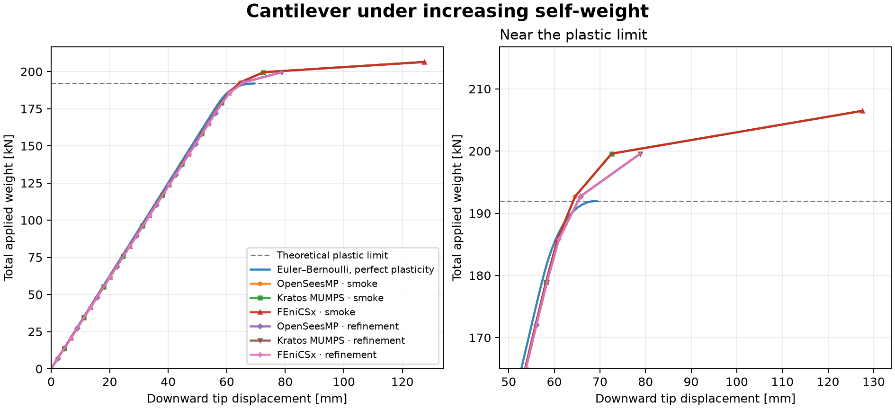

# Esmeralda rank scaling

Values are median launcher wall-clock seconds across validated repeats. Parentheses show how many of the three repeats contributed.
The CSVs also report solve and output times through 29× gravity.

## Smoke

90/90 runs validated.

| MPI ranks | Network | OpenSeesMP minimal | OpenSeesMP full | Kratos MUMPS minimal | Kratos MUMPS full | FEniCSx minimal | FEniCSx full |
| ---: | --- | ---: | ---: | ---: | ---: | ---: | ---: |
| 4 | Single node | 13.36 (3/3) | 18.18 (3/3) | 23.06 (3/3) | 27.13 (3/3) | 12.17 (3/3) | 12.53 (3/3) |
| 8 | Single node | 12.21 (3/3) | 13.03 (3/3) | 24.54 (3/3) | 26.73 (3/3) | 12.23 (3/3) | 12.42 (3/3) |
| 16 | Single node | 16.02 (3/3) | 15.06 (3/3) | 25.45 (3/3) | 31.24 (3/3) | 15.70 (3/3) | 15.65 (3/3) |
| 32 | RoCE | 25.67 (3/3) | 26.36 (3/3) | 41.47 (3/3) | 42.32 (3/3) | 23.76 (3/3) | 24.18 (3/3) |
| 32 | TCP | 29.36 (3/3) | 29.98 (3/3) | 46.85 (3/3) | 47.42 (3/3) | 30.17 (3/3) | 30.18 (3/3) |

- OpenSeesMP history from job 9532 (16 ranks).
- Kratos MUMPS history from job 9505 (16 ranks).
- FEniCSx history from job 9544 (16 ranks).

## Refinement

90/90 runs validated.

| MPI ranks | Network | OpenSeesMP minimal | OpenSeesMP full | Kratos MUMPS minimal | Kratos MUMPS full | FEniCSx minimal | FEniCSx full |
| ---: | --- | ---: | ---: | ---: | ---: | ---: | ---: |
| 4 | Single node | 206.95 (3/3) | 261.92 (3/3) | 327.26 (3/3) | 364.11 (3/3) | 168.12 (3/3) | 168.38 (3/3) |
| 8 | Single node | 202.03 (3/3) | 199.62 (3/3) | 308.43 (3/3) | 328.39 (3/3) | 174.78 (3/3) | 166.86 (3/3) |
| 16 | Single node | 202.43 (3/3) | 218.71 (3/3) | 275.94 (3/3) | 354.11 (3/3) | 162.56 (3/3) | 163.26 (3/3) |
| 32 | RoCE | 144.81 (3/3) | 149.58 (3/3) | 247.28 (3/3) | 253.22 (3/3) | 108.96 (3/3) | 111.45 (3/3) |
| 32 | TCP | 177.08 (3/3) | 182.29 (3/3) | 269.81 (3/3) | 274.84 (3/3) | 128.06 (3/3) | 129.41 (3/3) |

- OpenSeesMP history from job 9625 (16 ranks).
- Kratos MUMPS history from job 9598 (16 ranks).
- FEniCSx history from job 9637 (16 ranks).

## Force–displacement

The pure-bending reference reaches its plastic limit at 191.98 kN (27.895× gravity).

[Curve data](force-displacement.csv)
