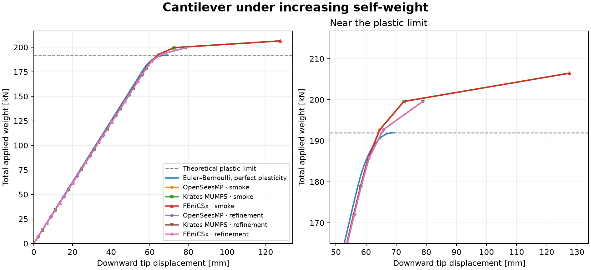

# Esmeralda rank scaling and beam limit

[Illustrated model report](../../REPORT.md) · [Node13 timing tables](node13-timings.md) · [Original timing tables](scaling-timings.md) · [Hardware](hardware.md) · [ParaView instructions](../VISUALIZATION.md) · [GPU pilots](gpu-pilot.md)

The two sweeps use the same 6 m steel cantilever, small-strain J2 perfect plasticity, and Gmsh ten-node tetrahedra. Kratos uses the installed Amesos MUMPS backend. Each mesh has 90 runs covering 4, 8, 16 and 32 MPI ranks, minimal and full output, and three repeats per setting. The 32-rank runs use 16 physical cores on each of nodes 12 and 13, with separate RoCE and TCP runs. The other tiers fit on one node.

| Mesh | T10 elements | Nodes | Load history | Slurm jobs |
| --- | ---: | ---: | --- | --- |
| Smoke | 7,140 | 13,041 | 30 steps of 1× gravity | 9489–9578 |
| Refinement | 69,600 | 116,781 | 29 steps of 1× gravity | 9582–9671 |

All 180 runs validated. Three 16-rank nonlinear full-output checks at 29× gravity (9579–9581) qualified the fine sweep. The first 29 load increments match across the two meshes. For a like-for-like mesh comparison, the CSVs include solve and output times summed over those 29 steps. The smoke wall times also include the difficult 30th increment.

Post-run investigation identified a memory misconfiguration on node12 that slowed that host. The single-node repeats were unevenly distributed across node12 and node13, and every 32-rank run used both hosts. The tables record performance under the hardware configurations in place during the campaign.

## Force–displacement

The vertical axis is the resultant of the uniform gravity load, $F=\lambda\rho A L g$, and the horizontal axis is the downward displacement at the free-end measurement point. The dashed line is the classical pure-bending limit. At the clamp, $M=FL/2$. With a plastic section modulus of $Z_p=0.00230375\,\mathrm{m^3}$ and $f_y=250\,\mathrm{MPa}$, the fully plastic root moment is $M_p=f_y Z_p=575.94\,\mathrm{kN\,m}$. This gives **$F_p=2M_p/L=191.98\,\mathrm{kN}$** at **27.895× gravity**. First yield in this beam reference is 167.54 kN at 24.344× gravity. [MIT mechanics of materials](https://ocw.mit.edu/courses/2-002-mechanics-and-materials-ii-spring-2004/00cf4c30d2a4c4573f78f2950809e765_2002_lab_sheet.pdf)

For the solid blue reference curve, the script integrates the capped uniaxial stress through the I-section to obtain moment versus curvature. It inverts that relation along the span and integrates $\kappa(x)(L-x)$ from clamp to tip. The reference reaches 69.30 mm downward tip displacement at the pure-bending limit. The 3D solid has a fully constrained end face, shear, and multiaxial stresses, so its near-clamp response differs from the beam idealization. [MIT beam deflections](https://ocw.mit.edu/courses/1-050-solid-mechanics-fall-2004/f9a4d5764b9b0f51ffaacbdf69f7aed8_emech10_04.pdf)

OpenSeesMP, Kratos, and FEniCSx overlap at this scale on each mesh. At 29× gravity, the representative 16-rank runs differ by 0.002 µm on the smoke mesh and 0.012 µm on the fine mesh.

| Gravity | Applied weight (kN) | Smoke tip down (mm), FEniCSx | Fine tip down (mm), FEniCSx |
| ---: | ---: | ---: | ---: |
| 27× | 185.82 | 60.71 | 61.01 |
| 28× | 192.70 | 64.56 | 65.71 |
| 29× | 199.58 | 72.57 | 78.84 |
| 30× | 206.47 | 127.53 | — |

At 29× the fine mesh deflects 6.27 mm more, an 8.6% increase, at a load 4.0% above the theoretical beam limit. The fine pilot stopped when Newton failed at 30×. The 3D limit load remains undetermined from these force-controlled increments. [Plotted data](force-displacement.csv) · [Reference values](force-displacement-reference.json) · [Plot code](../../tools/force_displacement.py)

## Timing and I/O results on Esmeralda

At 32 ranks with full output on the fine mesh, RoCE reduced median wall time versus TCP by 17.9% for OpenSeesMP, 7.9% for Kratos, and 13.9% for FEniCSx. Each solver reached its lowest fine-mesh wall time at 32 ranks over RoCE in both output modes. At that setting, each full run wrote about 0.98–0.99 GB of raw field files. The median time measured inside the field-output phase was 5.14 s for OpenSeesMP, 5.91 s for Kratos, and 0.58 s for FEniCSx. That phase includes extraction, serialization, and writes through the page cache. [Final timing tables](scaling-timings.md)

[Smoke medians](smoke-scaling-summary.csv) · [Smoke individual runs](smoke-scaling-measurements.csv) · [Fine medians](refinement-scaling-summary.csv) · [Fine individual runs](refinement-scaling-measurements.csv)

### OpenSeesMP single-node audit

All 18 fine-mesh OpenSeesMP runs at 4, 8, and 16 ranks used the same mesh hash and executable build. The inputs selected ParallelRCM and MUMPS, and the saved bindings mapped the requested ranks to distinct physical cores. Each run accepted 29 increments and accumulated 53 Newton iterations. The pooled medians combine runs from both hosts, with an uneven mix across rank counts.

| Fine mesh, minimal output | 4 ranks | 8 ranks | 16 ranks |
| --- | ---: | ---: | ---: |
| node12, median wall time and sample count | 229.52 s (1) | 211.10 s (2) | 202.48 s (2) |
| node13, median wall time and sample count | 206.83 s (2) | 168.46 s (1) | 158.78 s (1) |

These host-specific results show shorter wall times at higher ranks in the runs observed. The limited and uneven repeats leave the size of the same-host speedup uncertain. Job IDs appear in the [individual measurements](refinement-scaling-measurements.csv). Each job directory on Esmeralda contains its node in `nodelist` and its rank bindings in `binding.tsv`.

### Balanced node13 comparison

All 55 replacement jobs finished and validated. The follow-up combines 28 coarse and 27 fine reruns with 53 original node13 runs. The resulting comparison has 54 runs per mesh, three per solver, rank count, and output mode at 4, 8, and 16 ranks. The replacement runs used the archived inputs and original installed solver releases. Their final tip displacements, Newton iteration counts and field-output byte counts agreed with the replaced runs. [Node13 timing tables](node13-timings.md)

On the fine mesh at minimal output, OpenSeesMP and FEniCSx cut median wall time by 20.1% and 24.6% from 4 to 16 ranks. Kratos was fastest at 8 ranks in both output modes. All three solvers had their lowest coarse-mesh medians at 8 ranks. [Coarse medians](node13-coarse-summary.csv) · [Coarse repeats](node13-coarse-measurements.csv) · [Fine medians](node13-fine-summary.csv) · [Fine repeats](node13-fine-measurements.csv)

On Esmeralda, `runs/node13-scaling/replacements.tsv` maps the original job IDs to 9760–9814. Job 9816 wrote the coarse comparison to `runs/node13-scaling/coarse.md`. Job 9815 wrote both meshes to `runs/node13-scaling/benchmark.md`. The 32-rank transport comparison still uses the original campaign. [Job map](node13-replacements.tsv) · [Submission script](../../cluster/replay_node13.py)

All paths below are relative to `/mnt/covadongaflash/users/jaabell/three-way-benchmark`. The tables give median launcher wall time in seconds by solver, rank count, network and output mode. Each cell includes the number of validated repeats. The CSVs also report solve time, field-output time, field bytes, iterations and final tip displacement. Raw results, solver logs, node inventory and rank binding are kept in each case directory.

| File | Contents |
| --- | --- |
| `runs/smoke-scaling/submissions.tsv` | Smoke cases and Slurm IDs |
| `runs/refinement-scaling/submissions.tsv` | Fine cases and Slurm IDs |
| `runs/scaling-report/smoke.md` | Smoke timing table, written by job 9672 |
| `runs/scaling-report/benchmark.md` | Both timing tables, written by job 9673 |
| `runs/scaling-report/force-displacement.png` and `.csv` | Representative accepted full-output histories across both meshes, written by job 9673 |
| `summary.csv`, `measurements.csv`, `validation.log` in each suite | Grouped medians and ranges, individual run results, and any excluded cases |
